<p align="center">
  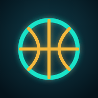
</p>

<h1 align="center">Perfect Season</h1>

<p align="center"><b>Spin a team and a decade. Draft the legends. Chase 82–0.</b><br>
NBA · NFL · Soccer, built for iPhone, free to play in your browser.</p>

<p align="center">
  <a href="https://qemmhd.github.io/perfect-season/"></a>
</p>

<p align="center">
  <a href="#install-it-on-your-iphone">Add to Home Screen</a> ·
  <a href="#whats-new">What's New</a> ·
  <a href="docs/README.md">Docs</a> ·
  <a href="docs/DEVELOPMENT.md">Development</a> ·
  <a href="#credits">Credits</a>
</p>

---

<table>
  <tr>
    <td align="center">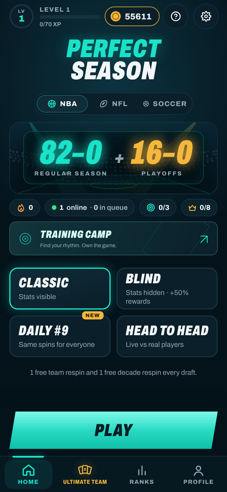<br><sub>Three sports, one switch</sub></td>
    <td align="center">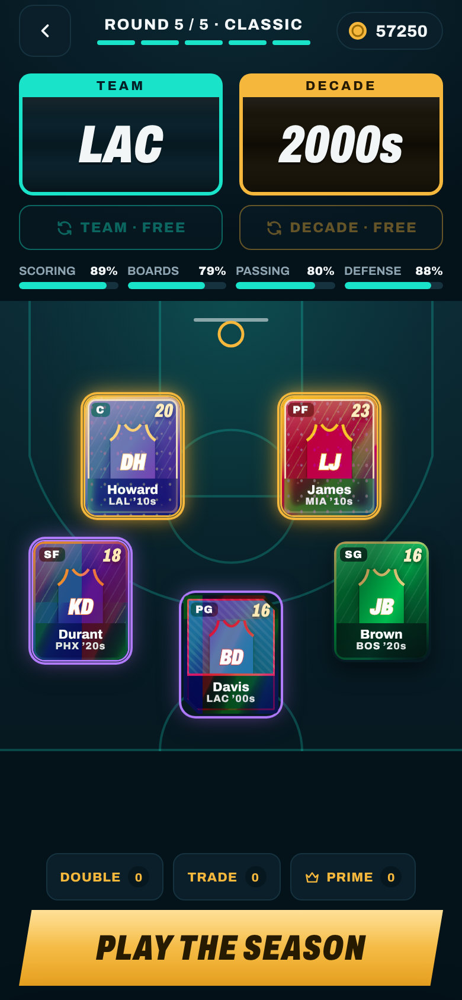<br><sub>Draft from real rosters</sub></td>
    <td align="center">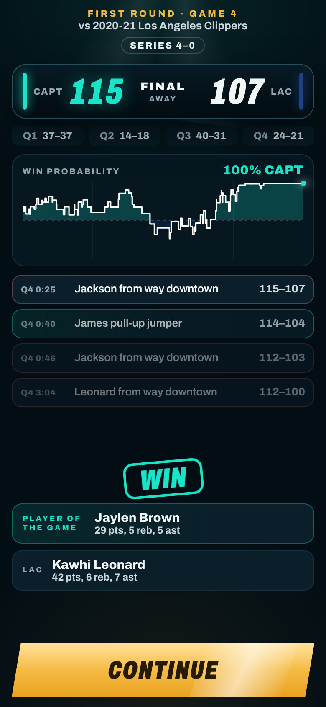<br><sub>Live playoff GameCast</sub></td>
    <td align="center">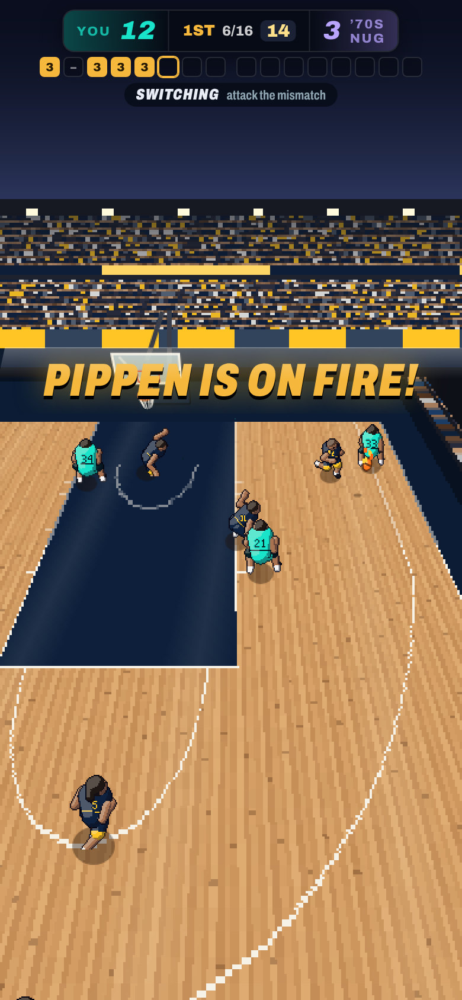<br><sub>Arcade basketball</sub></td>
    <td align="center">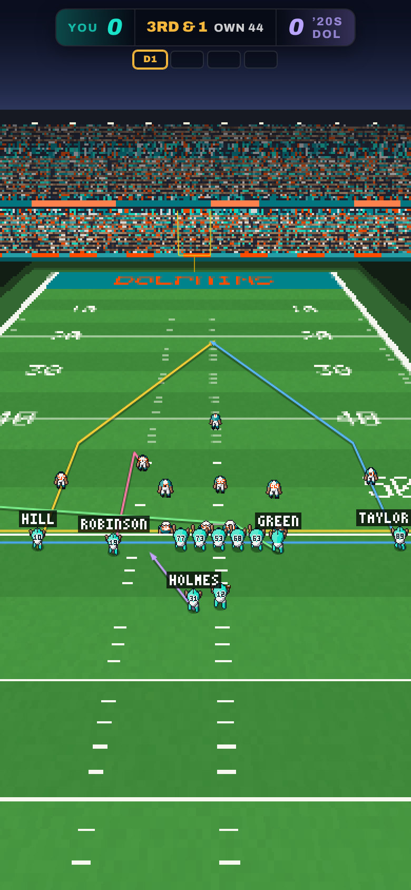<br><sub>Arcade football</sub></td>
  </tr>
  <tr>
    <td align="center">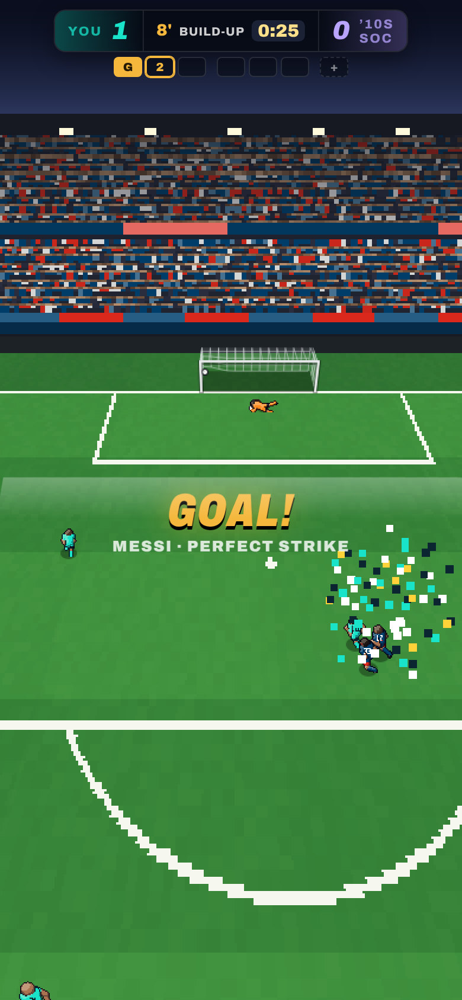<br><sub>Arcade soccer</sub></td>
    <td align="center">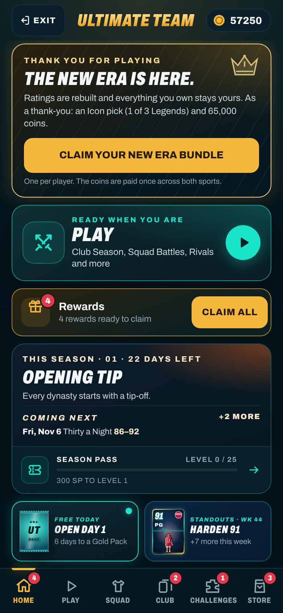<br><sub>Ultimate Team hub</sub></td>
    <td align="center">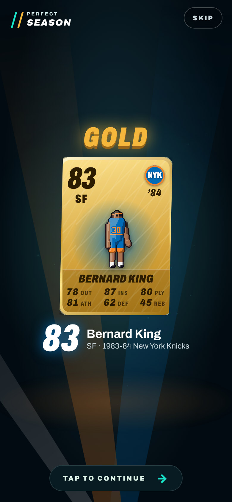<br><sub>Open packs</sub></td>
    <td align="center">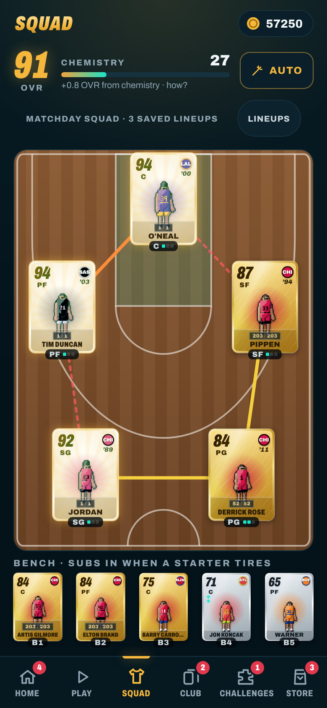<br><sub>Build your squad</sub></td>
    <td align="center">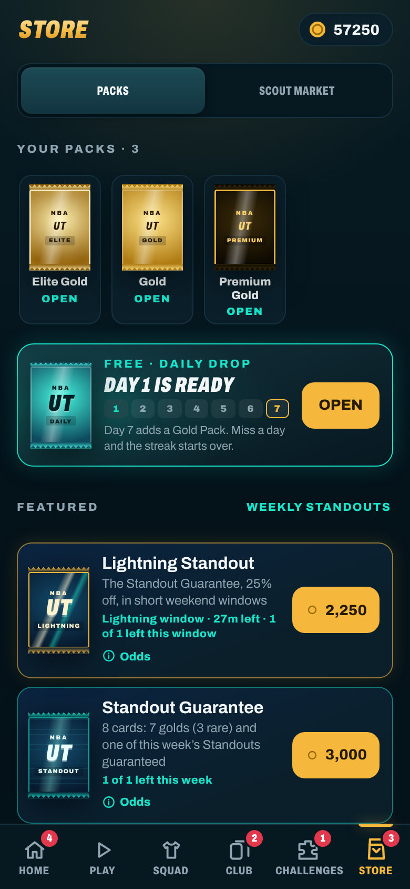<br><sub>Free daily packs</sub></td>
  </tr>
</table>

<sub>Screenshots are from the season-update build on an iPhone-sized screen (390 × 844), using a made-up demo profile.</sub>

## Install it on your iPhone

1. Open **[qemmhd.github.io/perfect-season](https://qemmhd.github.io/perfect-season/)** in **Safari**.
2. Tap **Share**, then **Add to Home Screen**, then **Add**.
3. Launch it from the new icon. It opens full screen like a native app, with its own launch screen.

It works offline once installed, updates itself on the next launch (never mid-draft), and remembers your progress. On Android, use Chrome's **Install app** / **Add to Home screen**. On a computer it plays in a phone-shaped frame.

## Features

### Draft a Perfect Season
- **Spin the reels** for a franchise and a decade, then draft anyone who really played for them. Every NBA season since 1959–60, every NFL season since the 1970 merger, and forty great soccer clubs from the 1950s to the 2020s.
- **Chase perfection:** 82–0 and 16–0 in the playoffs; 17–0 and four playoff wins; 38–0 and a clean cup run.
- **Watch it unfold:** a season ticker, playoff series against all-time great teams you can scout, and a live **GameCast** with win probability and play-by-play.
- **Modes:** Classic, Blind (stats hidden, +50% rewards), Daily (same spins for everyone), Head to Head and the Legends Gauntlet. Boosters, missions, a daily chest and a streak flame keep you coming back.

### Arcade games
- **Play the match yourself** on real pixel-art courts, fields and pitches with motion-captured players, a joystick and context buttons.
- **Basketball:** a timing shot meter, badges like Deadeye and Posterizer, catching fire, physical rebounds and help defense.
- **Football:** a playbook, bullet, touch and lob throws, receiver routes, jukes and trucks, real blocking and pursuit.
- **Soccer:** play your attacks with passes, through balls, crosses, power shots and set pieces; a draw goes to penalties.
- **Training Camp** drills to practise the controls, and SIM for when you'd rather watch.

### Ultimate Team
- **Collect cards** for real player seasons and legends, with attributes that carry into the game.
- **Build a squad** on the court, field or pitch, with chemistry links, formations and saved lineups.
- **Play your way:** Club Season (a full league and playoffs), Squad Battles, Champions Circuit, Legends Events, Moments, UT Draft, and online Rivals.
- **Progress:** SBCs, objectives, a Season Pass, Evolutions, Set collections and card levels.
- **Open packs** with a walkout for the big pulls, buy from the daily Scout Market, and chase numbered Spotlight and GOAT editions.

### Online & Leaderboards
- **Head to Head against real players:** Quick Match, or a friend code or invite link. The AI steps in if no one is around.
- **Global leaderboards** for Daily, Classic, Blind and Head to Head, checked on every phone, plus your personal bests.
- **Rivals divisions** for online Ultimate Team matches.
- **No sign-up:** your phone signs with its own key, and your progress is saved automatically to an encrypted cloud save.

### Three sports
- **NBA, NFL and Soccer** each have their own draft game, arcade engine, Ultimate Team, boards and queues.
- Your name, coins, level and settings are shared, so one wallet works everywhere.

## What's New

### The New Era season update

> Released 2026-11-01. Close and reopen the home-screen app (once or twice) to pick it up.

**Pack Tracker**
- Every pack you open is logged: per pack type you see packs opened, coins spent, value returned and your 86+/90+ rate next to the expected odds, plus a recent-pulls feed and every card you've pulled. Ultimate Team → Club → Pack Tracker, or Store → Pull History.

**Ultimate Team ratings, rebuilt on an FC-style scale**
- **Bronze 40–64 · Silver 65–74 · Gold 75–99.** Base cards top out at 91, Hot Season promos run 94–97 and Legends 88–95. Walkouts start at **86+**.
- Ratings were recalibrated against same-season NBA 2K and Madden ratings and NFL Combine data. Nothing you own was reset: every card, coin, level and serial stays yours.
- **New Era thank-you bundle:** players who were here before the update get one Icon pick (keep 1 of 3 Legends, 88+) and **65,000 coins**, once.

**New promos**
- **Weekly Standouts:** a new set of in-form season cards every week, with a featured card, its own SBC and a weekly objective.
- **Landmark Seasons:** cards for real statistical landmarks (30 points a game, 1,500-yard rushers, sack and interception titles and more), earned through SBCs and Sets.

**New packs**
- **Daily Drop:** a free pack every day, with a Gold Pack on day 7 of your streak.
- **Scout's Choice:** see three cards, keep one.
- **Elite Gold:** all rare golds, with a shot at a Standout or a Legend.
- **Jumbo Premium:** the big one, 16 cards in NBA and 32 in NFL.
- **Standout Guarantee:** a guaranteed Weekly Standout, plus a 25%-off **Lightning** copy in short weekend windows.
- **Preview Pack:** see a Premium Gold pack's exact cards before you decide.
- Every pack shows its odds, and Gold and Premium packs now guarantee rare golds.

**Live Calendar**
- A planned year of seasons, from **Opening Tip** through Holiday Hoops, **Hot Season** (94–97 Honors in January), Playoff Push and Draft Night, to the **Perfect Season Finale** in June, and then it keeps going.
- Each season brings program cards, program packs and season SBCs. Home shows **This Season** and what's **Coming next**.

**More to do**
- **Evolutions lab:** upgrade the cards you love by playing with them.
- **Set Collections:** franchise, decade, program and landmark sets that count every card you've discovered.
- **Item Score SBCs:** streamlined SBCs that take any cards, duplicates included, toward a points target.
- **Scout Market** (12 cards a day) and the **Swap Desk** (5 duplicate golds for a Scout's Choice).
- **UT Draft:** draft a squad one pick at a time and win up to four matches.
- **Chemistry pips** on every starter, a 5-day **login calendar**, holographic card variants, walkout clues, Pack Helper tags and a **Rewards inbox** with CLAIM ALL.

**Gameplay: ratings matter more**
- In basketball, elite shooters score more, strength wins at contact, and badges have tiers.
- In football, all 16 player abilities work, the run game is real, and route running and the pass rush follow the ratings.
- Screen shake, hit-stop, particles, dunk styles and iPhone haptics make big plays feel big. They change only how plays look, never how they turn out.

**Reorganised navigation**
- Main tabs: **Home · Ultimate Team · Ranks · Profile**.
- Ultimate Team tabs: **Home · Play · Squad · Club · Challenges · Store**, with every screen at most two taps from its tab.

**Soccer, the third sport**
- The draft game, a 38-game season and cup, an arcade match engine, and Ultimate Team with about 30,000 season cards and 132 Legends. FC-style tiers, formations and chemistry are included.
- Some features aren't in soccer yet, such as Club Season, the Live Calendar and Landmarks; see [SOCCER.md](docs/SOCCER.md).

Full details: [UT-CONTENT-2.md](docs/UT-CONTENT-2.md) · [RATINGS-AUDIT.md](docs/RATINGS-AUDIT.md) · [GAMEPLAY-RATINGS.md](docs/GAMEPLAY-RATINGS.md) · [UI-NAVIGATION.md](docs/UI-NAVIGATION.md) · [SOCCER.md](docs/SOCCER.md).

## Coins only, no real money

Perfect Season is free. Every pack, pick and booster costs **coins you earn by playing**: matches, objectives, the Season Pass, daily rewards and events. There is nothing to buy with real money, no ads, and no account to create. Pack odds are shown in the Store.

## Documentation

- [Docs index](docs/README.md): every document, grouped by Gameplay, Ultimate Team, Ratings & Data, Soccer, UI, QA & Release and Notes.
- [Development guide](docs/DEVELOPMENT.md): run, test, build and deploy; online limits; data sources and audits; code map; tuning.
- [CLAUDE.md](CLAUDE.md): handoff for contributors, covering the save rules that protect player progress and the module map.
- [Working notes](docs/notes/README.md): owner instructions, decisions, research and plans, by category.

```bash
npm install
npm run dev     # local dev server
npm test        # NBA, NFL and soccer test suites
npm run build   # static site in dist/ (GitHub Pages)
```

## Credits

- **Data:** Basketball-Reference and Pro-Football-Reference (via public datasets), nflverse, NFL Combine results, open Transfermarkt-derived soccer datasets and Wikidata. Ultimate Team benchmarks also use public NBA 2K and Madden ratings. Motion capture, sounds and every other source, with licences, are listed in **[docs/CREDITS.md](docs/CREDITS.md)**.
- **Built by AI, directed by the owner.** The original game was built with Claude (Anthropic). Codex (OpenAI) added large parts of the game, including Ultimate Team's clubhouse, Club Season, cloud saves, the court and field overhaul and pack cinema. Claude built the New Era season update and soccer. Every change, with its author, date, files and tests, is recorded in [docs/CODEX-UPDATE-LOG.md](docs/CODEX-UPDATE-LOG.md).
- Perfect Season is a fan-made game. It is not affiliated with or endorsed by the NBA, NFL, any soccer league or club, EA, or 2K. It uses no team logos.
